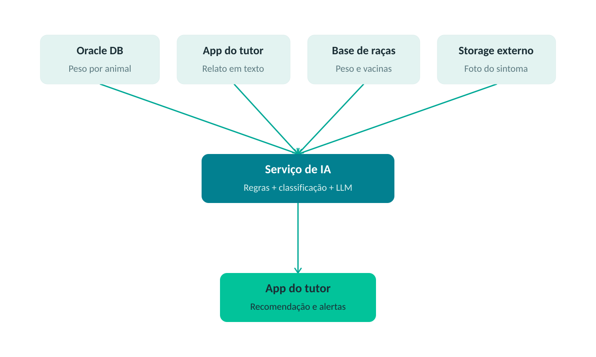

# Sistema IoT de Pesagem Animal com ESP32, HX711, MQTT, Node-RED e Oracle

## 📖 Sobre o Projeto

Este projeto consiste em um sistema IoT para monitoramento de peso animal utilizando:

- ESP32;
- Sensor HX711;
- Célula de carga de 50kg;
- MQTT;
- Node-RED;
- Oracle Database.

O sistema realiza:
1. leitura do peso do animal através da célula de carga;
2. geração de um nome aleatório para simular diferentes animais;
3. envio dos dados via MQTT;
4. processamento dos dados no Node-RED;
5. armazenamento automático no banco Oracle;
6. visualização em dashboard em tempo real.

---

# 🧠 Arquitetura do Sistema

```txt
Célula de Carga
        ↓
      HX711
        ↓
      ESP32
        ↓
      MQTT
        ↓
    Node-RED
        ↓
Dashboard + Oracle Database
```

---

# 🛠 Tecnologias Utilizadas

## Hardware
- ESP32
- HX711
- Célula de carga 50kg

## Software
- Arduino IDE
- Node-RED
- HiveMQ Cloud
- Oracle Database

---

# 📦 Formato dos Dados

Os dados enviados seguem o padrão:

```txt
peso,nomeDoAnimal
```

Exemplo:

```txt
10.5,Jake
```

---

# 🔌 Ligações HX711 → ESP32

| HX711 | ESP32 |
|---|---|
| VCC | 3.3V |
| GND | GND |
| DT | GPIO 4 |
| SCK | GPIO 5 |

---

# 📚 Bibliotecas Necessárias

Instalar na Arduino IDE:

- HX711 Library (Bogde)

---

# 🚀 Como Executar o Projeto

# 1️⃣ Configurar Arduino IDE

## Instalar ESP32 Board

Na Arduino IDE:
1. Abra:
   - Arquivo → Preferências
2. Adicione:
   
```txt
https://raw.githubusercontent.com/espressif/arduino-esp32/gh-pages/package_esp32_index.json
```

3. Vá em:
   - Ferramentas → Placa → Gerenciador de Placas
4. Instale:
   - ESP32 by Espressif Systems

---

# 2️⃣ Instalar Biblioteca HX711

Na Arduino IDE:
1. Sketch → Incluir Biblioteca → Gerenciar Bibliotecas
2. Pesquise:
   
```txt
HX711
```

3. Instale:
- HX711 by Bogde

---

# 3️⃣ Código do ESP32

## 📄 main.ino

```cpp
#include "HX711.h"

// ============================
// PINOS HX711
// ============================
#define DT  4
#define SCK 5

HX711 scale;

// ============================
// NOMES DOS ANIMAIS
// ============================
String animalNames[6] = {
  "Jake",
  "Max",
  "Luna",
  "Bella",
  "Thor",
  "Mel"
};

// ============================
// FATOR DE CALIBRAÇÃO
// ============================
//
// VOCÊ PRECISA AJUSTAR ESSE VALOR
// conforme sua célula de carga.
//
float calibration_factor = 0.0;

// ============================

void setup() {
  Serial.begin(115200);

  Serial.println("Inicializando HX711...");

  // Inicializa HX711
  scale.begin(DT, SCK);

  // Define fator de calibração
  scale.set_scale(calibration_factor);

  // Zera balança
  scale.tare();

  Serial.println("HX711 iniciado com sucesso!");
  Serial.println("Balança zerada!");

  randomSeed(millis());
}

void loop() {

  // ============================
  // LEITURA DO PESO
  // ============================

  // Média de 10 leituras
  float weight = scale.get_units(10);

  // Evita negativos pequenos
  if (weight < 0) {
    weight = 0;
  }

  // ============================
  // NOME ALEATÓRIO
  // ============================

  int randomIndex = random(0, 6);

  String animalName = animalNames[randomIndex];

  // ============================
  // PAYLOAD
  // ============================

  // Formato:
  // peso,nome
  //
  // Exemplo:
  // 10.5,Jake

  String payload = String(weight, 1) + "," + animalName;

  // ============================
  // ENVIO SERIAL
  // ============================

  Serial.println(payload);

  delay(5000);
}
```

---

# ⚖️ Calibrando a Célula de Carga

O valor:

```cpp
float calibration_factor = 0.0;
```

precisa ser ajustado conforme sua célula de carga.

## Processo de calibração

1. Execute o código;
2. Abra o Serial Monitor;
3. Coloque um peso conhecido sobre a balança;
4. Ajuste o valor do `calibration_factor` até a leitura ficar correta.

Exemplo:

```cpp
float calibration_factor = -7050.0;
```

ou:

```cpp
float calibration_factor = 2280.0;
```

O valor varia conforme:
- célula de carga;
- montagem física;
- orientação dos fios.

---

# 4️⃣ Configurar o MQTT (HiveMQ)

Criar conta no HiveMQ Cloud.

Configurar:
- cluster MQTT;
- usuário;
- senha.

Utilizar as mesmas credenciais:
- no ESP32;
- no Node-RED.

---

# 5️⃣ Configurar o Node-RED

## Importar o fluxo JSON

1. Abra o Node-RED;
2. Clique no menu;
3. Import;
4. Cole o JSON do fluxo;
5. Deploy.

---

# 🔄 Funcionamento do Fluxo

## MQTT IN

Recebe os dados enviados pelo ESP32.

Exemplo recebido:

```txt
10.5,Jake
```

---

## Function

Transforma os dados em objeto JSON.

Código:

```javascript
const parts = msg.payload.split(',');

msg.payload = {
    READING: Number(parts[0]),
    ANIMAL: parts[1]
};

return msg;
```

Resultado:

```json
{
  "READING": 10.5,
  "ANIMAL": "Jake"
}
```

---

## OracleDB

O Node-RED executa automaticamente:

```sql
INSERT INTO T_EXAM_READING
(READING, ANIMAL, DATETIME)
VALUES
(:READING, :ANIMAL, SYSDATE)
```

---

# 🗄 Estrutura da Tabela Oracle

```sql
CREATE TABLE T_EXAM_READING (
    ID NUMBER GENERATED ALWAYS AS IDENTITY,
    READING NUMBER(10,2),
    ANIMAL VARCHAR2(100),
    DATETIME DATE
);
```

---

# 📊 Dashboard

O dashboard do Node-RED exibe:
- gráfico em tempo real;
- gauge de peso;
- debug das mensagens;
- retorno Oracle.

---

# 📈 Exemplo de Fluxo Completo

## ESP32 envia:

```txt
12.4,Thor
```

## Node-RED transforma:

```json
{
  "READING": 12.4,
  "ANIMAL": "Thor"
}
```

## Oracle armazena:

| READING | ANIMAL | DATETIME |
|---|---|---|
| 12.4 | Thor | 24/05/2026 |

---

# ✅ Resultado Final

O sistema permite:
- monitoramento automático de peso;
- integração IoT com MQTT;
- processamento em tempo real;
- visualização em dashboard;
- persistência em Oracle Database.

---

# 👨‍💻 Objetivo Acadêmico

Projeto desenvolvido para estudos de:
- IoT;
- sensores;
- MQTT;
- Node-RED;
- Oracle Database;
- integração entre hardware e software.

---

---

# 🤖 Componente de IA (Sprint 3 — Disruptive Architectures: IoT, IoB & Generative IA)

> Esta seção documenta a definição do componente de IA que será integrado à solução. A Sprint 3 é uma etapa de definição/documentação; a implementação acontece na Sprint 4.

## Problema de negócio

O tutor do animal frequentemente não sabe interpretar sinais do próprio pet — perda ou ganho de peso, uma mancha na pele, mudança de comportamento, falta de apetite — e não tem clareza se aquilo exige atenção imediata, acompanhamento, ou é irrelevante.

A IA funciona como uma **camada de triagem contínua**: cruza o sinal (automático, vindo do sensor de peso, ou relatado manualmente pelo tutor em texto ou foto) com o histórico do animal e com conhecimento veterinário de referência, e devolve uma recomendação de ação. É um único motor de decisão com múltiplas entradas, não funcionalidades paralelas.

**Escopo inicial de espécies:** cão e gato.

## Abordagem de IA e justificativa técnica

| Tipo de sinal | Técnica | Por quê |
|---|---|---|
| Peso (dado numérico, já coletado pelo sensor) | Motor de regras inteligentes / classificação leve | Dado estruturado já existente; não exige dataset de treino |
| Relato do tutor em texto livre (ex: "não está comendo direito") | NLP via LLM | Texto variado, sem base rotulada disponível para treinar um classificador do zero |
| Foto de sintoma (ex: mancha na pele) | Visão computacional via **LLM multimodal** | A foto é enviada direto pro mesmo LLM, que já interpreta imagem nativamente — evita treinar e manter um classificador de imagem próprio |
| Cuidados/vacinas por espécie e raça | Base de conhecimento curada + LLM (RAG simples) | Conhecimento veterinário estruturado como contexto evita que o LLM "alucine" recomendações erradas |

O LLM atua como **camada de orquestração**: recebe o resultado da regra de peso (se aplicável), o texto do tutor, a foto do sintoma (quando enviada) e o trecho relevante da base de cuidados, e devolve uma única recomendação coerente.

## Dados necessários

Evolução do schema Oracle atual (hoje `T_EXAM_READING` guarda o nome do animal como texto solto):

```sql
CREATE TABLE T_ANIMAL (
    ID          NUMBER GENERATED ALWAYS AS IDENTITY,
    NAME        VARCHAR2(100),
    SPECIES     VARCHAR2(20),   -- CACHORRO | GATO
    BREED       VARCHAR2(100),
    BIRTH_DATE  DATE
);

-- evolução da tabela atual: ANIMAL (texto) vira ANIMAL_ID (FK)
CREATE TABLE T_EXAM_READING (
    ID         NUMBER GENERATED ALWAYS AS IDENTITY,
    ANIMAL_ID  NUMBER REFERENCES T_ANIMAL(ID),
    READING    NUMBER(10,2),
    DATETIME   DATE
);

CREATE TABLE T_TUTOR_REPORT (
    ID           NUMBER GENERATED ALWAYS AS IDENTITY,
    ANIMAL_ID    NUMBER REFERENCES T_ANIMAL(ID),
    REPORT_TEXT  VARCHAR2(2000),  -- nullable, quando o relato for só foto
    IMAGE_URL    VARCHAR2(500),   -- nullable, link pro storage externo (a imagem NÃO fica no Oracle)
    REPORT_DATE  DATE
);

CREATE TABLE T_BREED_CARE (
    ID               NUMBER GENERATED ALWAYS AS IDENTITY,
    SPECIES          VARCHAR2(20),
    BREED            VARCHAR2(100),
    MIN_WEIGHT       NUMBER(10,2),
    MAX_WEIGHT       NUMBER(10,2),
    VACCINE_SCHEDULE CLOB,
    CARE_NOTES       CLOB
);

CREATE TABLE T_AI_RECOMMENDATION (
    ID                    NUMBER GENERATED ALWAYS AS IDENTITY,
    ANIMAL_ID             NUMBER REFERENCES T_ANIMAL(ID),
    SOURCE                VARCHAR2(20),   -- PESO | RELATO | CUIDADO_RACA
    RECOMMENDATION_TEXT   CLOB,
    CREATED_AT            DATE
);
```

`T_AI_RECOMMENDATION` não é exigida pelo enunciado, mas registra toda recomendação gerada pela IA para fins de rastreabilidade/auditoria.

## Arquitetura do componente de IA



<details>
<summary>Versão em texto do diagrama</summary>

```
 [Oracle DB]    [App do tutor]   [Base de raças]   [Storage externo]
 Peso por        Relato em        Peso ideal e      Foto do sintoma
 animal          texto            vacinas           (link no Oracle)
     \                |                |                 /
      \               |                |                /
       \              v                v               /
        --------->  [Serviço de IA]  <---------------
                Regras + classificação + LLM multimodal
                              |
                              v
                       [App do tutor]
                    Recomendação e alertas
                              |
                              v
                (grava em T_AI_RECOMMENDATION)
```
</details>

- As quatro fontes (peso do sensor, relato do tutor, base de raças, foto do sintoma) alimentam o Serviço de IA.
- A foto vai para um storage externo (ex: S3/bucket); o Oracle guarda só o link (`T_TUTOR_REPORT.IMAGE_URL`).
- O Serviço de IA devolve a recomendação para o mesmo app do tutor — ponto de entrada e de saída.
- Toda recomendação é registrada no Oracle para auditoria futura.

---

#### [Video no youtube](https://youtu.be/CoorQwypCCo)