# CLYVO VET · IoT e IA de triagem

Challenge FIAP 2026 · 2TDS · disciplina **Disruptive Architectures: IoT, IoB & Generative IA** · Sprint 4.

Uma balança IoT pesa o animal e, junto com o relato do tutor (texto e foto) e uma base de cuidados por raça, alimenta uma **IA de triagem** que devolve ao tutor uma orientação com nível de urgência (NORMAL, ATENÇÃO ou ALERTA) e registra tudo no Oracle para o acompanhamento contínuo da saúde do pet.

## Integrantes

| Nome | RM |
|---|---|
| Ana Carolina Pereira Fontes | 562145 |
| João Victor Nascimento Adão | 563409 |
| Johnny Dias Mathias Junior | 566516 |
| Luisa Ganasevici de Abreu | 563403 |
| Matheus Moya de Oliveira | 562822 |

## Sumário

1. [O problema e a solução](#1-o-problema-e-a-solução)
2. [Arquitetura implementada](#2-arquitetura-implementada)
3. [Como a IA funciona](#3-como-a-ia-funciona)
4. [Sprint 3 × Sprint 4: o que foi definido e o que foi implementado](#4-sprint-3--sprint-4-o-que-foi-definido-e-o-que-foi-implementado)
5. [Tecnologias](#5-tecnologias)
6. [Estrutura do repositório](#6-estrutura-do-repositório)
7. [Modelo de dados](#7-modelo-de-dados)
8. [API](#8-api)
9. [Como executar](#9-como-executar)
10. [Testes e validação](#10-testes-e-validação)
11. [Resultados e evidências](#11-resultados-e-evidências)
12. [Segurança e limitações](#12-segurança-e-limitações)
13. [Vídeos](#13-vídeos)

---

## 1. O problema e a solução

O tutor frequentemente não sabe interpretar sinais do próprio pet: perda ou ganho de peso, uma mancha na pele, falta de apetite. Ele não tem clareza se aquilo exige atenção imediata, acompanhamento ou é irrelevante, e a clínica só fica sabendo quando o problema já se agravou.

A IA funciona como uma **camada de triagem contínua**, com três entradas e um único motor de decisão:

| Entrada | De onde vem | O que a IA devolve |
|---|---|---|
| **Peso** | Balança IoT (ESP32 + HX711), a cada pesagem | Nível e orientação quando o peso foge da faixa da raça ou varia demais |
| **Relato do tutor** | App do tutor: texto livre e/ou foto do sintoma | Nível e orientação, com trava de segurança para sinais de emergência |
| **Plano de cuidados** | Base de cuidados por raça + idade + peso | Vacinas e cuidados preventivos personalizados |

**Benefícios para o tutor:** sabe na hora se precisa correr para o veterinário, acompanhar ou só manter a rotina, com orientação específica para a raça do animal.
**Benefícios para a clínica:** histórico de pesagens, relatos e orientações por animal, com o nível de cada uma (`ALERT_LEVEL`), para priorizar quem precisa de contato.

Escopo: cães e gatos.

---

## 2. Arquitetura implementada

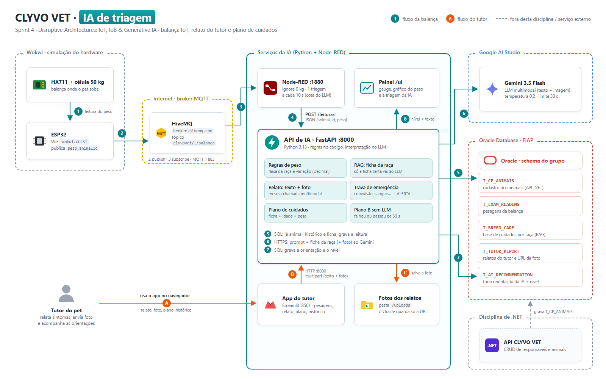

O desenho é gerado a partir de [`docs/arquitetura-sprint4.html`](docs/arquitetura-sprint4.html). O diagrama da Sprint 3, que era a proposta, continua em [`docs/diagrama-arquitetura-ia.png`](docs/diagrama-arquitetura-ia.png).

**Fluxo da balança (1 a 8):**
1. O HX711 lê a célula de carga.
2. O ESP32 (simulado no Wokwi) publica `peso,animalId` no tópico `clyvovet/fiap2026/balanca` do broker HiveMQ.
3. O Node-RED assina o tópico, ignora 0 kg (balança vazia) e deixa passar no máximo **1 triagem a cada 10 s**, para não estourar a cota do LLM (o ESP32 publica a cada 2 s).
4. O Node-RED chama `POST /leituras` na API.
5. A API lê o animal, o histórico e a ficha da raça no Oracle e grava a leitura.
6. Se o nível não for NORMAL, a API envia ao Gemini a regra, os números e a ficha da raça.
7. A API grava a orientação e o nível em `T_AI_RECOMMENDATION`.
8. A resposta volta ao Node-RED, que mostra o peso e a triagem no painel `/ui`.

**Fluxo do tutor (A a C):** o tutor usa o app (Streamlit), que só conversa com a API (A, B). Relatos podem levar foto, guardada fora do banco; o Oracle guarda só a URL (C).

**Decisão central: a API é a única porta para o banco e para o LLM.** O Node-RED não grava mais direto no Oracle, como fazia nas Sprints 1 e 2, e o app do tutor não conhece o banco. Assim a regra de negócio fica num lugar só, testável, e a balança e o app recebem exatamente a mesma triagem.

---

## 3. Como a IA funciona

A IA segue um princípio: **regras objetivas no código, interpretação no LLM**. Um LLM não é determinístico. Ele pode "arredondar" um limite, inventar uma causa ou mudar de resposta entre duas execuções iguais. Por isso tudo o que é objetivo (limites, classificação, escolha da ficha, sinais de emergência) é decidido em Python e testado, e o LLM recebe o resultado pronto para explicar e recomendar.

### 3.1 Triagem de peso: motor de regras + LLM

Arquivo: [`ia/dominio/peso.py`](ia/dominio/peso.py) e [`ia/servicos/triagem_peso.py`](ia/servicos/triagem_peso.py).

| Regra | Resultado |
|---|---|
| Peso fora da faixa da raça (`T_BREED_CARE`), com os limites contando como dentro | ATENÇÃO |
| Variação de mais de 5% até 10% em relação à **média das últimas 5 pesagens** | ATENÇÃO |
| Variação acima de 10% | ALERTA |
| Primeira pesagem (sem histórico) | Compara com o peso do cadastro (`T_CP_ANIMAIS.WEIGHT`) |
| Peso ≤ 0 (balança vazia) | Não é avaliado |

O nível final é o mais grave entre os problemas. Decisões que valem destacar:
- **`Decimal` em vez de `float`:** o `float` guarda 0,1 como 0,1000000000000000055…, e uma conta bem no limite cairia do lado errado. O peso vem do Oracle (`NUMBER(10,2)`) direto como `Decimal`.
- **Sem arredondar antes de comparar:** 5,05% arredondado para 5% passaria como normal. O arredondamento acontece só no texto mostrado.
- **Média das últimas 5 pesagens, e não só a anterior:** a célula de carga oscila um pouco a cada leitura; a média é o "peso de costume" do animal.
- **NORMAL não chama o LLM:** não há o que interpretar, e o plano gratuito do Gemini tem limite por minuto e por dia. A orientação sai de um texto fixo e é registrada mesmo assim.

### 3.2 RAG simples: a ficha da raça

Arquivo: [`ia/dominio/cuidados.py`](ia/dominio/cuidados.py) e [`ia/sql/02_seed_cuidados_racas.sql`](ia/sql/02_seed_cuidados_racas.sql).

A base de conhecimento é a tabela `T_BREED_CARE`, com 12 fichas curadas (8 de cães e 4 de gatos): faixa de peso adulto, calendário de vacinas e cuidados da raça. A **recuperação** (o "R" de RAG) é feita em código: o nome da raça do animal é normalizado (sem acento, maiúsculo) e comparado com as fichas da espécie: nome igual, depois nome contido ("Labrador" encontra "Labrador Retriever"), e por fim a ficha genérica **SRD** da espécie. Só essa ficha vai para o prompt.

Por que isso, e não o LLM puro: o modelo responde com o que está na ficha da clínica, e não com o que "acha" sobre a raça, o que reduz alucinação em orientação de saúde. Por que não embeddings: com 12 fichas e uma chave natural (espécie + raça), uma busca exata é mais previsível e testável que uma busca vetorial.

### 3.3 Relato do tutor: NLP e visão via LLM multimodal

Arquivo: [`ia/dominio/relato.py`](ia/dominio/relato.py) e [`ia/servicos/triagem_relato.py`](ia/servicos/triagem_relato.py).

- O texto e a foto vão **na mesma chamada** ao Gemini, que lê imagem nativamente. Isso evita treinar e manter um classificador de imagem próprio, como a Sprint 3 já previa.
- Aqui não existe regra numérica possível ("está coçando a orelha"), então **o LLM classifica o nível**, numa primeira linha fixa (`Nível: ALERTA`) que o código lê. Se o modelo fugir do formato, o nível vira ATENÇÃO.
- **Trava de emergência em código:** palavras como convulsão, sangue, veneno, gengiva roxa ou "não consegue respirar" forçam **ALERTA**, mesmo que o modelo diga outra coisa. O código só pode subir o nível, nunca baixar.
- Validação antes de gravar: texto até 2000 caracteres; foto JPG, PNG ou WEBP de até 5 MB.
- A foto vai para um storage fora do Oracle (na demo, a pasta `ia/uploads`, servida pela API em `/uploads`); `T_TUTOR_REPORT.IMAGE_URL` guarda só o link.

### 3.4 Plano de cuidados por raça

Arquivo: [`ia/servicos/plano_cuidados.py`](ia/servicos/plano_cuidados.py). Combina a ficha da raça com a **idade** (calculada pela data de nascimento) e o peso do cadastro: um filhote recebe o esquema de doses de filhote, e um adulto, os reforços anuais. Registrado com origem `CUIDADO_RACA`.

### 3.5 Instruções do LLM (prompt) e plano B

Arquivo: [`ia/servicos/prompts.py`](ia/servicos/prompts.py) e [`ia/llm/gemini.py`](ia/llm/gemini.py).

- O nível decidido pelo sistema não pode ser alterado; usar só os dados e a ficha enviados; da ficha, só o que tem relação com o problema; **não fazer diagnóstico nem indicar remédio**; sinal de emergência é sempre "atendimento imediato", nunca "agendar consulta"; formato fixo (Resumo / O que fazer / Quando procurar o veterinário).
- `gemini-3.5-flash` com temperatura 0,2 (orientação consistente) e **limite de 30 s** por chamada.
- **Plano B:** se o Gemini falhar (chave, cota, rede, tempo), o tutor recebe a orientação montada pelas regras ou pela própria ficha, a recomendação é gravada mesmo assim, e o motivo aparece em `motivo_sem_llm`.
- O LLM fica atrás de um contrato (`ClienteLLM`): em produção é o Gemini; nos testes, um dublê que responde o combinado. O serviço não sabe qual dos dois está usando.

---

## 4. Sprint 3 × Sprint 4: o que foi definido e o que foi implementado

A Sprint 3 definiu o componente de IA ([vídeo da Sprint 3](https://youtu.be/CoorQwypCCo)). A Sprint 4 implementou essa definição e evoluiu alguns pontos:

| Definido na Sprint 3 | Implementado na Sprint 4 | |
|---|---|---|
| Peso: motor de regras / classificação leve | Regras de faixa da raça e variação, com gabarito de testes | ✅ |
| Relato em texto: NLP via LLM | Gemini classifica e orienta, com trava de emergência em código | ✅ |
| Foto do sintoma: LLM multimodal | Texto + foto na mesma chamada ao Gemini | ✅ |
| Cuidados por raça: base curada + LLM (RAG simples) | `T_BREED_CARE` com 12 fichas e recuperação por raça | ✅ |
| LLM como camada de orquestração | O LLM recebe regra, números e ficha e escreve uma orientação única | ✅ |
| Foto em storage externo, link no Oracle | Pasta servida pela API, URL em `T_TUTOR_REPORT.IMAGE_URL` | ✅ |
| App do tutor como entrada e saída | App em Streamlit falando com a API | ✅ |
| Toda recomendação registrada | `T_AI_RECOMMENDATION` | ✅ |
| `T_ANIMAL` | Usa a `T_CP_ANIMAIS`, o cadastro que a API .NET da CLYVO VET já mantém (mesmos campos) | 🔼 evolução |
| `T_EXAM_READING` com `ANIMAL_ID` | Criada no schema da aplicação; o ESP32 envia o ID do animal (no mundo real, a tag RFID da coleira) | ✅ |
| — | `ALERT_LEVEL` em `T_AI_RECOMMENDATION`, para a clínica priorizar | 🔼 evolução |
| — | Primeira pesagem comparada com o peso do cadastro | 🔼 evolução |
| — | Plano B sem LLM e limite de tempo | 🔼 evolução |

**Por que `T_CP_ANIMAIS` em vez de `T_ANIMAL`:** o PDF da Sprint 4 pede a IA integrada à aplicação da CLYVO VET. Criar uma segunda tabela de animais deixaria a IA isolada; usando o cadastro da API .NET, um animal criado no app da clínica já é pesado e triado pela IA. As chaves estrangeiras para ele usam `ON DELETE CASCADE`, porque a API .NET apaga o animal fisicamente e, sem o cascade, o Oracle recusaria o DELETE de um animal que tem pesagens.

---

## 5. Tecnologias

| Camada | Tecnologia | Uso |
|---|---|---|
| Hardware (simulado) | ESP32 DevKit C v4, HX711, célula de carga 50 kg, [Wokwi](https://wokwi.com) | Balança |
| Firmware | Arduino (C++), bibliotecas HX711 e PubSubClient | Leitura e publicação MQTT |
| Mensageria | MQTT, broker público HiveMQ | Balança → Node-RED |
| Orquestração IoT | Node-RED + `node-red-dashboard` | Filtro, limitador, chamada à API, painel |
| API de IA | Python 3.13, FastAPI, Uvicorn, Pydantic | Regras, RAG, orquestração do LLM |
| LLM | Google Gemini 3.5 Flash (`google-genai`) | Texto e imagem |
| Banco | Oracle Database (FIAP), `python-oracledb` (modo thin) | Animais, pesagens, base de cuidados, relatos, recomendações |
| App do tutor | Streamlit + pandas | Interface |
| Testes | pytest, FastAPI `TestClient` | 87 testes automatizados |

---

## 6. Estrutura do repositório

```
IOT-AI/
├── animal-scale-iot.ino        # firmware do ESP32 (é o sketch.ino do Wokwi)
├── wokwi/                      # circuito (diagram.json) e bibliotecas do Wokwi
├── Wokwi link                  # link do projeto no Wokwi
├── flows.json                  # fluxo do Node-RED (importar no editor)
├── docs/                       # diagramas e evidências
└── ia/                         # serviço de IA em Python
    ├── dominio/                # regras puras: peso, relato, ficha da raça, idade
    ├── repositorios/oracle.py  # acesso ao Oracle (pool + repositórios)
    ├── llm/                    # contrato ClienteLLM e implementação Gemini
    ├── servicos/               # triagem de peso, relato, plano de cuidados, prompts
    ├── armazenamento/          # storage das fotos
    ├── api/                    # FastAPI: rotas e esquemas
    ├── interface/app.py        # app do tutor (Streamlit)
    ├── sql/                    # DDL das tabelas e seed da base de cuidados
    ├── scripts/                # testes manuais com banco e Gemini reais
    ├── tests/                  # gabarito em pytest e dublês
    ├── .env.example            # modelo das variáveis de ambiente
    └── requirements.txt
```

**Por que essas camadas:** o `dominio` não conhece banco nem LLM, então as regras são testadas sem internet; os `servicos` recebem repositórios e LLM por contrato (`Protocol`), e por isso os testes trocam o Oracle e o Gemini por dublês; a `api` só traduz HTTP em chamadas aos serviços, e os erros do domínio viram 404 ou 422 num lugar só.

---

## 7. Modelo de dados

Scripts: [`ia/sql/01_tabelas_ia.sql`](ia/sql/01_tabelas_ia.sql) (tabelas) e [`ia/sql/02_seed_cuidados_racas.sql`](ia/sql/02_seed_cuidados_racas.sql) (base de cuidados).

| Tabela | Papel | Campos principais |
|---|---|---|
| `T_CP_ANIMAIS` | Cadastro dos animais (criada pela API .NET) | `ID`, `NAME`, `SPECIES` (DOG/CAT), `BREED`, `BIRTH_DATE`, `WEIGHT` |
| `T_EXAM_READING` | Pesagens da balança | `ID`, `ANIMAL_ID` → `T_CP_ANIMAIS`, `READING`, `DATETIME` |
| `T_BREED_CARE` | Base de cuidados por raça (RAG) | `SPECIES`, `BREED` (única por espécie), `MIN_WEIGHT`, `MAX_WEIGHT`, `VACCINE_SCHEDULE`, `CARE_NOTES` |
| `T_TUTOR_REPORT` | Relatos do tutor | `ANIMAL_ID`, `REPORT_TEXT`, `IMAGE_URL` (texto ou foto obrigatório), `REPORT_DATE` |
| `T_AI_RECOMMENDATION` | Toda orientação da IA | `ANIMAL_ID`, `SOURCE` (PESO/RELATO/CUIDADO_RACA), `ALERT_LEVEL` (NORMAL/ATENCAO/ALERTA), `RECOMMENDATION_TEXT`, `CREATED_AT` |

Os valores aceitos ficam garantidos no próprio banco por `CHECK`. A ficha `SRD` de cada espécie é a reserva quando a raça não está na base; a do cão SRD não tem faixa de peso, porque um vira-lata pode ter 5 kg ou 40 kg, e para ele vale só a variação. Os valores da base são referências gerais de vacinação e de padrão de raça: orientam a triagem e **não substituem a avaliação do veterinário**.

---

## 8. API

Documentação interativa (Swagger) em `http://localhost:8000/docs`.

| Verbo | Rota | Descrição | Quem chama |
|---|---|---|---|
| GET | `/health` | Verifica se a API está no ar | — |
| GET | `/animais` | Animais ativos do cadastro | App do tutor |
| GET | `/animais/{id}/leituras` | Pesagens do animal | App do tutor |
| GET | `/animais/{id}/recomendacoes` | Histórico de orientações da IA | App do tutor |
| POST | `/leituras` | Grava a pesagem e devolve a triagem (`{"animal_id": 1, "peso": 8.4}`) | Node-RED / app |
| POST | `/animais/{id}/relatos` | Relato do tutor (`multipart/form-data`: `texto`, `foto`) | App do tutor |
| POST | `/animais/{id}/plano-cuidados` | Plano de cuidados personalizado | App do tutor |

Respostas de erro: **404** para animal inexistente e **422** para dados inválidos (peso ≤ 0, relato vazio, arquivo que não é imagem), sempre com a mensagem em `detail`.

---

## 9. Como executar

**Pré-requisitos:** Python 3.13, Node.js LTS, acesso ao Oracle da FIAP (o mesmo schema da API .NET da CLYVO VET), uma chave do Gemini criada em [Google AI Studio](https://aistudio.google.com) e uma conta no Wokwi.

São quatro peças, cada uma em um terminal (ou aba) próprio. **A API sobe primeiro**, porque o app e o Node-RED só conversam com ela.

### 9.1 Banco (uma vez)
No SQL Developer, conectado ao schema da aplicação, rode com **F5** (Run Script):
1. `ia/sql/01_tabelas_ia.sql`
2. `ia/sql/02_seed_cuidados_racas.sql` (o SELECT final deve listar 12 fichas)

### 9.2 Terminal 1 · API de IA
```bash
cd ia
python -m venv .venv
.venv/Scripts/python -m pip install -r requirements.txt
cp .env.example .env          # preencher ORACLE_USER, ORACLE_PASSWORD, ORACLE_DSN e GEMINI_API_KEY
.venv/Scripts/python -m uvicorn api.main:app --reload
```
No ar quando aparecer `Application startup complete`. Teste em `http://localhost:8000/health` e `http://localhost:8000/docs`.

### 9.3 Terminal 2 · App do tutor
```bash
cd ia
.venv/Scripts/python -m streamlit run interface/app.py
```
Abre em `http://localhost:8501`.

### 9.4 Terminal 3 · Node-RED
```bash
npm install -g --unsafe-perm node-red     # no PowerShell: npm.cmd
node-red                                  # no PowerShell: node-red.cmd
```
No editor (`http://127.0.0.1:1880`):
1. ☰ → **Manage palette** → instalar `node-red-dashboard`.
2. ☰ → **Import** → `flows.json` → **Deploy**.
3. O nó MQTT deve ficar verde ("conectado"). O nó **"Simular balança"** testa o fluxo sem o Wokwi.

Painel em `http://127.0.0.1:1880/ui`.

### 9.5 Wokwi · balança
Abra o projeto do link em [`Wokwi link`](Wokwi%20link) e clique em ▶. O monitor Serial mostra `WiFi... conectado`, `MQTT... conectado` e `Publicado: <peso>,1`. Clique no HX711 para mudar o peso. Para pesar outro animal, troque `ANIMAL_ID` no código pelo ID dele em `T_CP_ANIMAIS`.

### 9.6 Testes manuais sem a interface (opcional)
```bash
.venv/Scripts/python -m scripts.verificar_banco 1       # conexão, animal, ficha e histórico
.venv/Scripts/python -m scripts.triagem_peso 1 18       # grava uma pesagem e mostra a triagem
```

---

## 10. Testes e validação

```bash
cd ia
.venv/Scripts/python -m pytest -v
```

**87 testes**, que rodam sem banco e sem internet: o Oracle e o Gemini são substituídos por dublês. Os cenários foram escritos **antes** da implementação, como um gabarito, incluindo valores exatamente nos limites.

| Arquivo | Testes | O que garante |
|---|---|---|
| `test_regras_peso.py` | 20 | Limites da faixa (inclusive), variação de exatamente 5% e 10%, média das últimas 5, peso do cadastro, sem arredondar antes de comparar, balança vazia |
| `test_cuidados.py` | 13 | Escolha da ficha (acento, espaços, nome parcial, sinônimos de SRD, ambiguidade) e conversão das linhas do Oracle |
| `test_triagem_peso.py` | 12 | Prompt com regra e ficha, NORMAL sem LLM, plano B com o motivo, leitura fora da própria média, nada gravado em caso de erro |
| `test_relato.py` | 22 | Validação de texto e foto, sinais de emergência, leitura do nível, foto enviada ao LLM, emergência forçando ALERTA, plano B |
| `test_plano_cuidados.py` | 9 | Cálculo da idade, ficha e idade no prompt, plano B com a própria ficha |
| `test_api.py` | 11 | Rotas, códigos 201/404/422, upload de foto, histórico |

**Validação com os serviços reais** (Oracle da FIAP e Gemini), além do pytest:
- Uma pesagem real expôs um furo na regra: um Pug (raça que ainda não estava na base) pesado com o dobro do peso saía NORMAL, porque não havia faixa nem histórico. A correção (comparar a primeira pesagem com o peso do cadastro) entrou com teste.
- A revisão do texto do Gemini mostrou "gengiva arroxeada" tratada como "agendar consulta". As instruções e as fichas foram corrigidas para tratar sinais de emergência como atendimento imediato, e o teste passou a exigir isso.
- Foto de teste que não mostrava a pele do animal: o Gemini descreveu só o que era visível e disse que a imagem não mostrava o animal, sem afirmar doença.

---

## 11. Resultados e evidências

> Prints em `docs/evidencias/`.

**Balança no Wokwi publicando no MQTT**
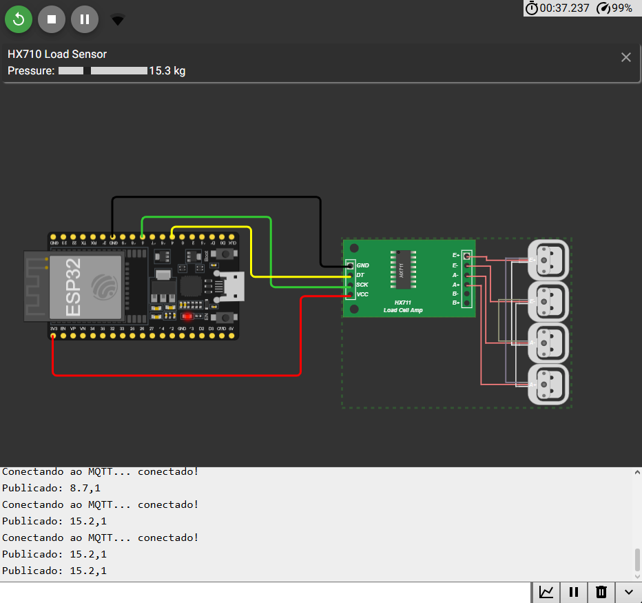

**Fluxo do Node-RED**
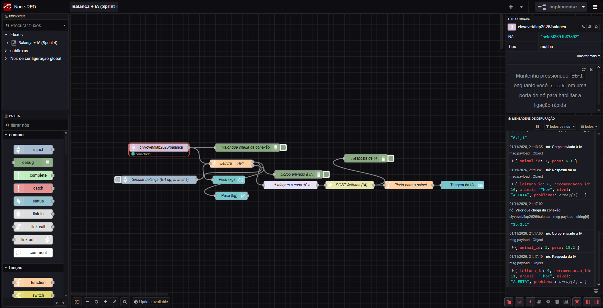

**Painel do Node-RED com a triagem da IA**
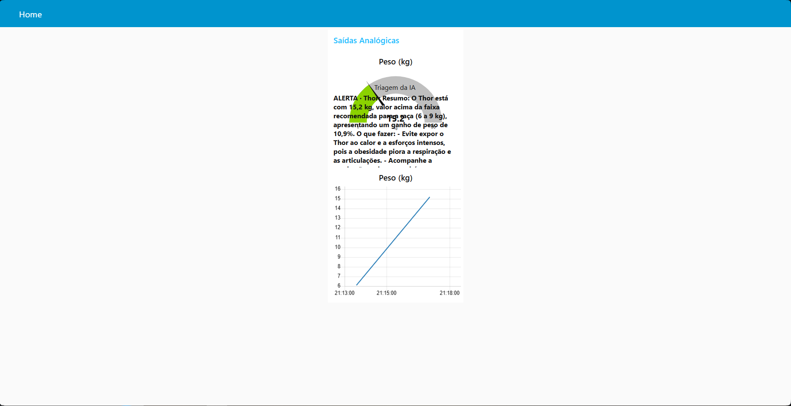

**API recebendo as pesagens (`POST /leituras` 201)**
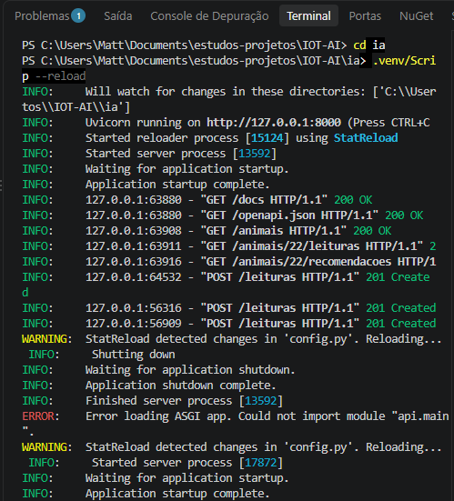

**Documentação da API (Swagger)**
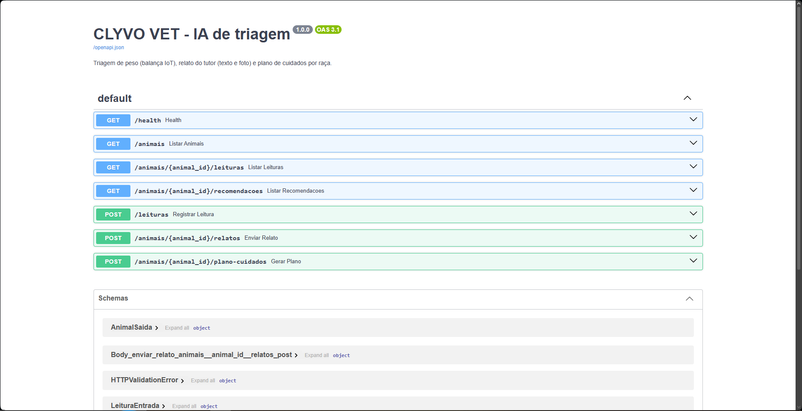

**App do tutor: pesagens e triagem**
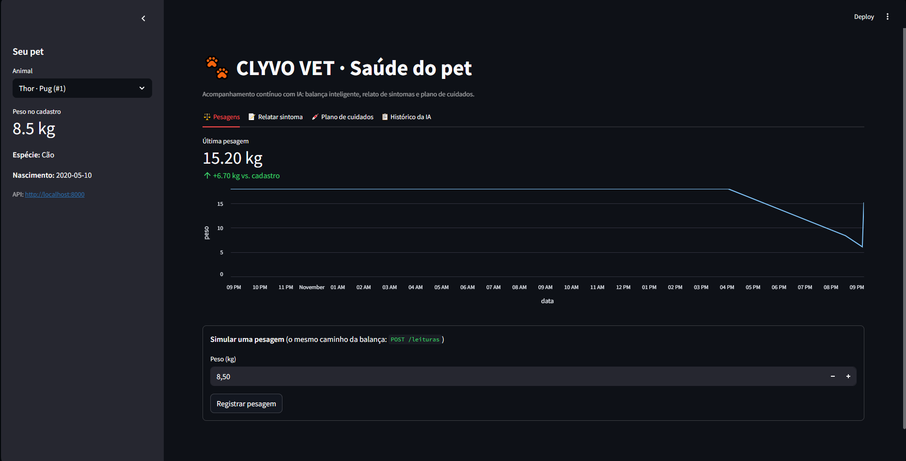

**App do tutor: relato com foto**
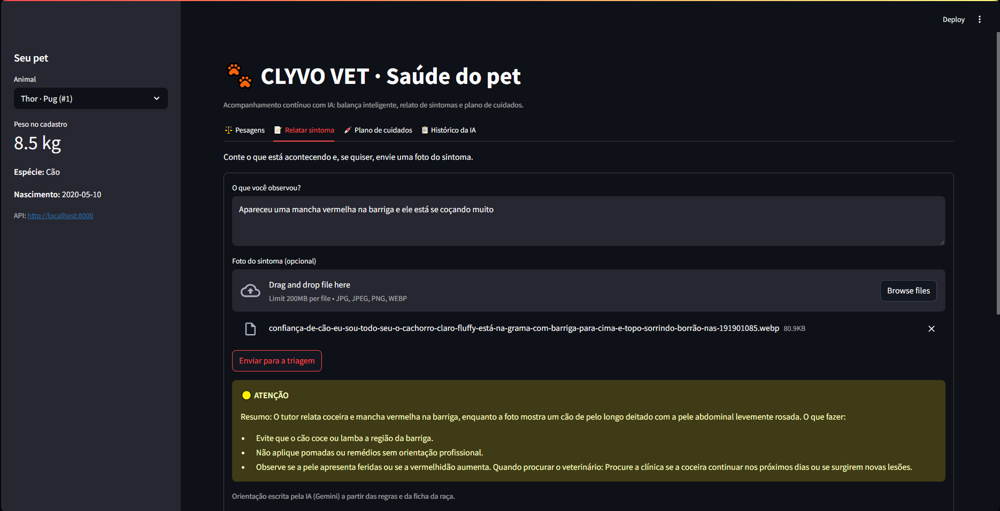

**App do tutor: plano de cuidados**
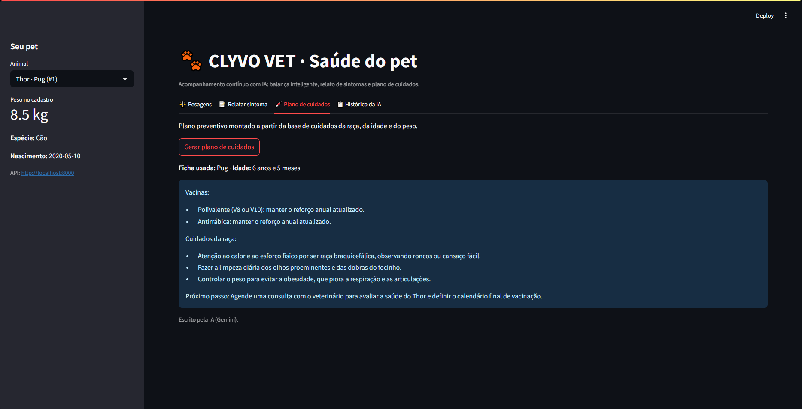

**App do tutor: histórico da IA**
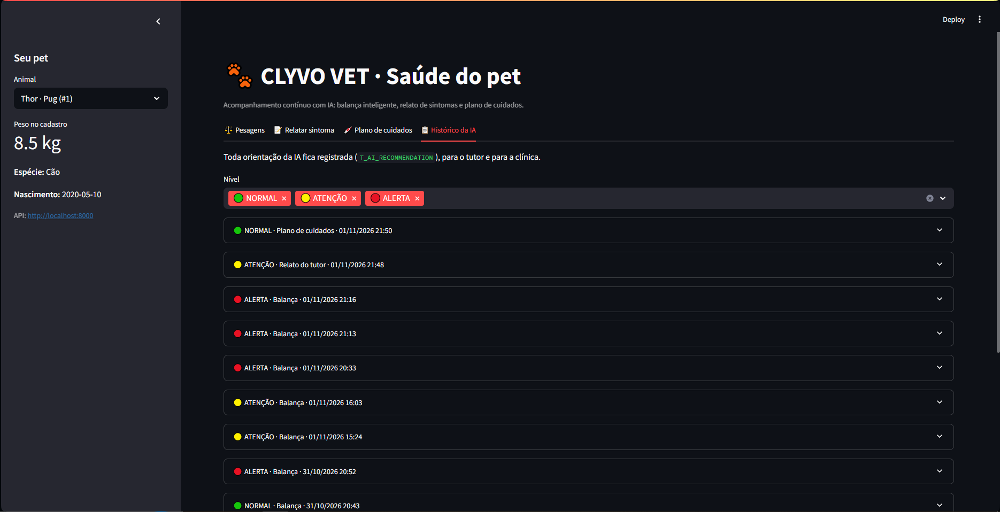

**Oracle: orientações registradas em `T_AI_RECOMMENDATION`**
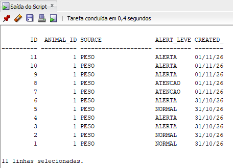

**Testes automatizados (87 passando)**
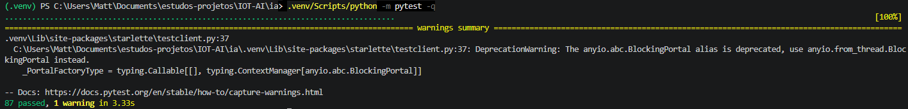

---

## 12. Segurança e limitações

- **Nenhuma credencial no repositório:** Oracle e Gemini vêm do `ia/.env`, que está no `.gitignore`; o repositório guarda só o `ia/.env.example` com valores de exemplo. A configuração recusa a chave de exemplo com uma mensagem clara.
- **A IA orienta, não diagnostica:** as instruções proíbem diagnóstico, remédio e dose, e todo ALERTA manda ao veterinário.
- **Broker MQTT público:** qualquer pessoa conectada ao `broker.hivemq.com` pode ler e publicar no tópico. Serve à demonstração, com pesos simulados; em produção seria um broker privado com usuário, senha e TLS. A API valida tudo o que chega (animal existente, peso > 0).
- **Fotos em pasta local:** na demo, as fotos ficam em `ia/uploads` (fora do Git). Em produção, o mesmo contrato de armazenamento apontaria para um bucket (S3, Azure Blob), sem o serviço mudar.
- **Identificação do animal na balança:** na simulação, o ESP32 envia um ID fixo (`ANIMAL_ID`); no mundo real, viria da leitura de uma tag RFID na coleira.
- **Cota do Gemini:** o plano gratuito tem limite por minuto e por dia; por isso o limitador do Node-RED, o NORMAL sem LLM e o plano B.

---

## 13. Vídeos

- Sprint 4 (implementação): `<inserir link do YouTube>`
- Sprint 3 (definição): https://youtu.be/CoorQwypCCo

<details>
<summary>Histórico: Sprints 1 e 2 (balança gravando direto no Oracle)</summary>

Nas Sprints 1 e 2, o ESP32 gerava um nome aleatório de animal e o Node-RED gravava `peso,nome` direto em `T_EXAM_READING` (colunas `READING`, `ANIMAL` e `DATETIME`). Na Sprint 4, o nome solto virou `ANIMAL_ID` (como a Sprint 3 definiu), e a gravação passou para a API, que também aciona a IA.

**Ligações HX711 → ESP32:** VCC → 3V3, GND → GND, DT → GPIO 4, SCK → GPIO 5.

**Calibração:** o `calibration_factor` (422,0 no Wokwi) depende da célula de carga, da montagem e da orientação dos fios. Para calibrar com hardware real, coloque um peso conhecido e ajuste o fator até a leitura bater.
</details>
